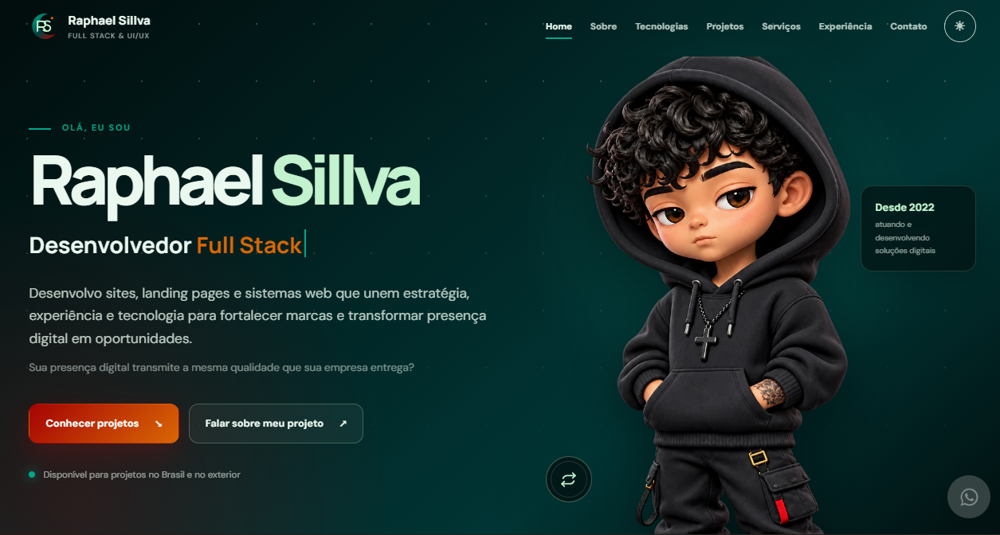

# 💼 Portfólio de Bruno Lima — Full Stack & Inteligência Artificial

Portfólio profissional **single page** de **Bruno Lima**, Desenvolvedor Full Stack e Especialista em Inteligência Artificial — apresentando projetos, skills e serviços que unem código, design e IA para gerar resultados reais.

🌐 **[Acessar portfólio online](https://Bruno-FullStack-AI.github.io/Portfolio-2026-Bruno-Full-tack/)**

## 🖥️ Preview



Criado a partir de engenharia reversa e rebranding para identidade **Full Stack & IA**.

---

## 🛠️ Tecnologias


Desenvolvido com **HTML semântico, CSS moderno e JavaScript modular**, sem frameworks — com integração pronta para APIs de IA (OpenAI, Gemini, etc.).

---

## ✨ Principais recursos

* 📱 Layout responsivo & mobile-first
* 🌙 Tema claro e escuro com persistência
* ⚡ JavaScript modular (ES Modules)
* ♿ Recursos de acessibilidade (skip-link, aria, focus-visible)
* 🎨 Identidade visual própria **BL** com monograma e lua
* 🤖 Seções dedicadas a **IA & Automação** (agentes, chatbots, dashboards inteligentes)
* 📬 Formulário de contato com fallback WhatsApp
* 🔎 SEO otimizado (Open Graph, Twitter Cards, Schema.org Person, sitemap)
* 🌐 Publicação GitHub Pages

---

## 🚀 Executar localmente

Como os scripts utilizam módulos ES, execute via servidor HTTP local:

```bash
# Python
python -m http.server 8000
# ou Node
npx serve .
```

Acesse `http://localhost:8000`

---

## 📁 Estrutura principal

* `index.html` — conteúdo, SEO e estrutura semântica (rebranded para Bruno Lima)
* `css/portfolio.css` — temas, componentes, animações e responsividade
* `js/main.js` — interações, tema, formulário, typing com IA roles, profile swap
* `js/projects.js` — dados dos projetos (inclui 3 projetos novos de IA)
* `data/contatos.json` — contatos e endpoint do formulário (centralizado)
* `assets/` — imagens, avatar, logo BL e preview
* `privacidade.html` — política de privacidade
* `site.webmanifest` — PWA / instalação
* `robots.txt` & `sitemap.xml` — SEO

---

## 📬 Formulário de contato

Envio assíncrono via **FormSubmit** com configuração em `data/contatos.json`:

```json
{
  "name": "Bruno Lima",
  "email": "contato@brunolima.dev",
  "whatsapp": "+55 11 99999-9999",
  "formEndpoint": "https://formsubmit.co/ajax/contato@brunolima.dev"
}
```

Fallback automático para WhatsApp se o endpoint falhar.

---

## 🌐 Publicação

Publicado via **GitHub Pages** em `https://Bruno-FullStack-AI.github.io/Portfolio-2026-Bruno-Full-tack/`

Inclui URLs canônicas, metadados sociais, robots, sitemap e manifest.

---

## 🧠 Projetos de IA em destaque

* **Agente IA WhatsApp** — qualificação e agendamento 24h
* **Dashboard Inteligente de Vendas** — insights automáticos com IA
* **Landing Page com IA Conversacional** — conversão guiada por assistente

Além de projetos conceituais web/sistemas reaproveitados do template original.

---

## 🎨 Identidade visual

Marca **BL** em `assets/logo/bruno-mark.svg` (dark) e `bruno-mark-light.svg` (light)

* Tema claro: `#B1CDF2` · `#97B5DE` · `#5271A1` · `#295187` · `#103778`
* Tema escuro: `#014040` · `#03A688` · `#C2F2CE` · `#A60303` · `#D96704`

Alternância automática via `portfolio-theme` no localStorage.

---

## 👨‍💻 Autor

**Bruno Lima** — Desenvolvedor Full Stack & Inteligência Artificial

* Fortaleza, CE — Brasil | Atendimento Brasil e exterior
* 📧 contato@brunolima.dev
* 💼 [LinkedIn](https://www.linkedin.com/in/bruno-lima-fullstack-ia/) | [GitHub](https://github.com/Bruno-FullStack-AI)

> "Inteligência que transforma limites em possibilidades."

---

> Baseado no template original de Raphael Sillva (https://github.com/rafael192612/portfolio-2026) — rebranding completo para Bruno Lima Full Stack & IA.
